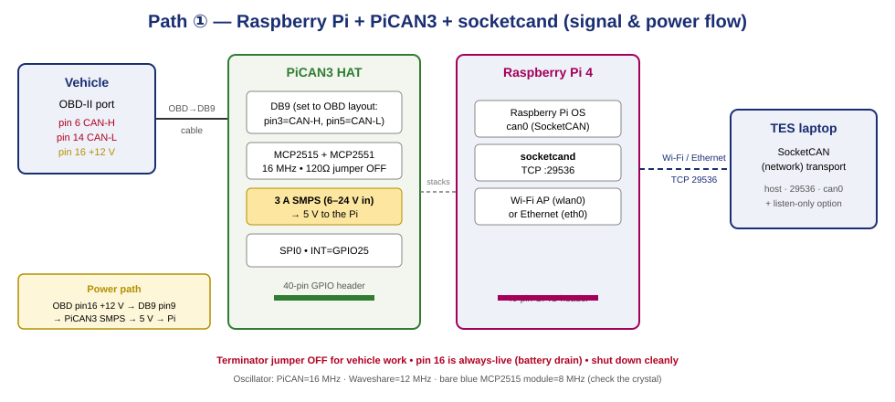

# Guide 01 — Raspberry Pi + SocketCAN + socketcand (Wi-Fi / Ethernet)

A wireless CAN interface for Tester Engineering Suite. A Raspberry Pi with a CAN HAT presents the
vehicle bus as a Linux **SocketCAN** device (`can0`), **socketcand** publishes it over TCP, and TES
connects to it from its **SocketCAN (network)** transport over Wi-Fi or Ethernet.



**This guide assumes a PiCAN3 HAT on a Raspberry Pi 4.** Waveshare HATs and bare MCP2515 modules
work too — only the oscillator value and the GPIO pins change (see [the oscillator table](#52-the-overlay-line--oscillator-is-the-1-gotcha)).

> ⚠️ Read the [safety section in the README](README.md#️-read-this-before-you-plug-anything-into-a-car) first. Short version: buzz out the cable, terminator **OFF** for vehicles, pin 16 is always-live, shut the Pi down cleanly, socketcand is unauthenticated.

---

## 1. What you need

| Item | Notes |
|------|-------|
| Raspberry Pi 4 (2 GB+) | Pi 3B+ also works. Pi 5 needs a Pi-5-compatible HAT. |
| CAN HAT | **PiCAN3** (3 A SMPS + RTC, 16 MHz) is the reference. See [Guide 03](03-Recommended-Hardware.md). |
| microSD card | 16 GB+, Class 10 / A1. |
| OBD-II → DB9 cable | CAN-H=OBD6→DB9 pin3, CAN-L=OBD14→DB9 pin5, +12 V=OBD16→DB9 pin9. |
| Power | From the vehicle via the PiCAN3 SMPS, **or** a bench 5 V USB-C / 12 V supply. |
| A second machine | To flash the SD card and to SSH in. |

> 📷 **PHOTO:** `diagrams/photos/01-parts-laid-out.jpg` — all the parts laid out before assembly.

---

## 2. Assemble the hardware

1. **Fit the HAT.** With the Pi **powered off**, press the PiCAN3 onto the 40-pin GPIO header. Use
   the standoffs/screws so it can't lift off.

   > 📷 **PHOTO:** `diagrams/photos/02-pican3-fitted.jpg` — PiCAN3 seated on the Pi, standoffs in.

2. **Terminator jumper — OFF for vehicles.** The PiCAN3 has a jumper that switches a 120 Ω
   terminating resistor across CAN-H/CAN-L. A vehicle bus is **already** terminated (60 Ω). Leave
   this jumper **off** for in-car work. Only fit it for a bench bus that has a single ECU on it.

   > 📷 **PHOTO:** `diagrams/photos/03-terminator-jumper.jpg` — close-up of the terminator jumper position.

3. **DB9 solder bridges — set the "OBD" layout.** By default the PiCAN DB9 follows the CiA DS-102
   standard (CAN-H on pin 7, CAN-L on pin 2, GND on pin 3). The cheap **OBD-II → DB9 cables** put
   **CAN-H on DB9 pin 3 and CAN-L on DB9 pin 5**, and +12 V on pin 9. To use one of those cables you
   must set the board's solder bridges to the OBD layout. The exact bridge labels vary by board
   revision — **follow your board's user guide** and then **confirm with a multimeter**:
   - DB9 **pin 3 → CAN-H**
   - DB9 **pin 5 → CAN-L**
   - DB9 **pin 9 → +12 V in** (feeds the SMPS, if powering from the vehicle)
   - DB9 **pin 1/2 → GND**

   See [`diagrams/db9-obd-pinout.svg`](diagrams/db9-obd-pinout.svg).

   > 📷 **PHOTO:** `diagrams/photos/04-solder-bridges.jpg` — the solder bridges as you set them.

4. **(Optional) Case.** Fit a PiCAN case with the DB9 cut-out so the board survives the toolbox.

> 🔎 **Don't want to touch solder bridges?** Use the PiCAN **3-way screw terminal** instead of the
> DB9: wire CAN-H, CAN-L and GND straight from an OBD-II breakout. No bridges, no custom cable.

---

## 3. Flash Raspberry Pi OS

Use **Raspberry Pi Imager** on your other machine.

1. Choose **Raspberry Pi OS Lite (64-bit)** (Bookworm). Lite is headless — perfect for this.
2. Click the ⚙️ (edit settings) and set:
   - **Hostname:** `tescan`
   - **Enable SSH** → *password authentication* (or paste a public key)
   - **Username/password** (remember them)
   - **Wi-Fi** — set your *home/workshop* network for first setup (we'll add the AP later)
   - **Locale/keyboard**
3. Write the card, put it in the Pi, power on, wait ~60 s, then SSH in:

```bash
ssh tescan@tescan.local        # or ssh tescan@<pi-ip>
sudo apt update && sudo apt full-upgrade -y
sudo apt install -y can-utils
```

---

## 4. Enable SPI

The MCP2515 talks to the Pi over SPI.

```bash
sudo raspi-config nonint do_spi 0      # 0 = enable
```

(Or `sudo raspi-config` → *Interface Options* → *SPI* → *Yes*.)

---

## 5. Add the MCP2515 device-tree overlay

### 5.1 Which config file?

- **Bookworm:** `/boot/firmware/config.txt`
- **Bullseye and older:** `/boot/config.txt`

```bash
sudo nano /boot/firmware/config.txt
```

### 5.2 The overlay line — oscillator is the #1 gotcha

Add these lines at the end:

```ini
dtparam=spi=on
dtoverlay=mcp2515-can0,oscillator=16000000,interrupt=25
# optional, helps on some boards:
# dtoverlay=spi0-0cs
```

**`oscillator=` MUST match the crystal on your board**, or `can0` will come up but every bit time is
wrong and you'll see nothing (or only errors). Read the crystal marking (`Y1`) on the board:

| Board | Crystal | `oscillator=` | `interrupt=` (INT GPIO) |
|-------|---------|---------------|--------------------------|
| **PiCAN2 / PiCAN3** | 16 MHz | `16000000` | `25` |
| **Waveshare RS485 CAN / 2-CH CAN HAT** | 12 MHz | `12000000` | `25` (check — some use 23) |
| **Bare blue MCP2515 module** | usually **8 MHz** (`8.000`) | `8000000` | the GPIO you wired INT to (commonly `25`) |

> The crystal is the little silver can near the MCP2515, usually printed `16.000`, `12.000` or `8.000`.

Save (`Ctrl-O`, `Enter`, `Ctrl-X`) and reboot:

```bash
sudo reboot
```

After reboot, confirm the driver loaded:

```bash
dmesg | grep -i mcp                 # should show "mcp251x spi0.0 can0: MCP2515 successfully initialized"
ip -details link show can0          # the interface should exist
```

If `can0` is missing, see [Troubleshooting](#11-troubleshooting).

---

## 6. Bring up `can0`

### 6.1 Manual (for a quick test)

```bash
# Light vehicle HS-CAN / OBD-II:
sudo ip link set can0 up type can bitrate 500000

# Heavy (J1939): 250000    |    Ford MS-CAN: 125000    |    J1939-14: 500000
ip -details -statistics link show can0     # state should be "ERROR-ACTIVE" / UP
```

### 6.2 Persistent — bring it up automatically at boot

A tiny `systemd` service is the most reliable method across Bookworm (it doesn't matter whether
NetworkManager or networkd is managing the box):

```bash
sudo tee /etc/systemd/system/can0.service >/dev/null <<'EOF'
[Unit]
Description=Bring up can0 (SocketCAN)
After=sys-subsystem-net-devices-can0.device
Wants=sys-subsystem-net-devices-can0.device

[Service]
Type=oneshot
RemainAfterExit=yes
# change 500000 to your bus speed
ExecStart=/sbin/ip link set can0 up type can bitrate 500000 restart-ms 100
ExecStop=/sbin/ip link set can0 down

[Install]
WantedBy=multi-user.target
EOF

sudo systemctl daemon-reload
sudo systemctl enable --now can0.service
systemctl status can0.service
```

> `restart-ms 100` auto-recovers the controller if it goes bus-off (e.g. a wrong-speed probe).

---

## 7. Test the CAN interface (before TES)

Prove the hardware works with `can-utils`:

```bash
# Terminal A — watch everything on the bus:
candump can0

# Terminal B — send an OBD-II request (Mode 01 PID 05 = coolant temp):
cansend can0 7DF#0201050000000000
```

On a **running vehicle** `candump` will scroll with live traffic and you should see a `7E8#...`
response to the request. If you have no vehicle handy, do a **loopback self-test** (no bus needed):

```bash
sudo ip link set can0 down
sudo ip link set can0 up type can bitrate 500000 loopback on
candump can0 &            # background
cansend can0 123#DEADBEEF # you should see your own frame echoed
kill %1
sudo ip link set can0 down
sudo ip link set can0 up type can bitrate 500000   # back to normal mode
```

> 📷 **PHOTO:** `diagrams/photos/05-candump-live.jpg` — `candump can0` scrolling with live vehicle traffic.

---

## 8. Install and run socketcand

**socketcand** bridges `can0` to a TCP port (default **29536**) using the protocol TES's SocketCAN
transport speaks.

```bash
sudo apt install -y socketcand
```

> If `apt` can't find it (older image), build it from source:
> ```bash
> sudo apt install -y git autoconf libtool build-essential
> git clone https://github.com/linux-can/socketcand.git
> cd socketcand && ./autogen.sh && ./configure && make && sudo make install
> ```

Run a quick foreground test (replace `10.42.0.1` with the Pi's AP/Ethernet IP from §9):

```bash
socketcand -v -i can0 -l 10.42.0.1 -p 29536
```

- `-i can0` — the CAN interface to publish
- `-l <ip>` — the **IP address to listen on**. Bind it to your AP/Ethernet IP, **not** `0.0.0.0`, so
  it isn't exposed on every interface.
- `-p 29536` — TCP port (TES's default)

`Ctrl-C` to stop, then install it as a service so it starts at boot:

```bash
sudo tee /etc/systemd/system/socketcand.service >/dev/null <<'EOF'
[Unit]
Description=socketcand - CAN over TCP for TES
After=network-online.target can0.service
Wants=network-online.target can0.service

[Service]
# -l must match the interface TES reaches the Pi on (see the AP / Ethernet IP in section 9)
ExecStart=/usr/bin/socketcand -i can0 -l 10.42.0.1 -p 29536 -n
Restart=on-failure
RestartSec=2

[Install]
WantedBy=multi-user.target
EOF

sudo systemctl daemon-reload
sudo systemctl enable --now socketcand.service
systemctl status socketcand.service
```

- `-n` disables the UDP discovery beacon (TES connects directly, so it isn't needed).
- Confirm it's listening: `sudo ss -tlnp | grep 29536`

---

## 9. Put the Pi on a network with TES

Pick **one**: a Wi-Fi access point (wireless, best for the shop) or Ethernet (simplest, most robust).

### 9.1 Option A — Wi-Fi access point (NetworkManager, Bookworm)

Bookworm ships NetworkManager, which can run an AP with one command:

```bash
# wlan0 = built-in Wi-Fi. SSID and password are yours; password >= 8 chars.
sudo nmcli device wifi hotspot ifname wlan0 ssid TES-CAN password "ChangeMe123"

# make it come back after a reboot:
sudo nmcli connection modify Hotspot connection.autoconnect yes

# find the Pi's AP address (usually 10.42.0.1):
nmcli -g IP4.ADDRESS device show wlan0
```

Your **TES laptop** then joins the `TES-CAN` Wi-Fi network and reaches the Pi at **`10.42.0.1`**.
(Use that IP for socketcand's `-l` in §8, and as the host in TES in §10.)

> Bind socketcand to the AP IP (`-l 10.42.0.1`) so the bus is only reachable by clients on your AP.

### 9.2 Option B — Ethernet (direct cable or switch)

Give the Pi a fixed address on `eth0` and connect it to the laptop directly (modern Pis auto-MDIX,
so a straight cable is fine) or through a small switch:

```bash
sudo nmcli connection modify "Wired connection 1" \
    ipv4.method manual ipv4.addresses 192.168.50.1/24
sudo nmcli connection up "Wired connection 1"
```

Set your **laptop's** Ethernet adapter to a static `192.168.50.2 / 255.255.255.0`. The Pi is then at
**`192.168.50.1`** (use that for socketcand `-l` and the TES host).

Test from the laptop: `ping 192.168.50.1`.

---

## 10. Connect from Tester Engineering Suite

1. In TES, open the **Developer** menu → **SocketCAN (network)** (this is the entry that calls the
   socketcand transport).
2. Fill the dialog:

   | Field | Value |
   |-------|-------|
   | **Host** | the Pi's IP — `10.42.0.1` (AP) or `192.168.50.1` (Ethernet) |
   | **Port** | `29536` |
   | **Interface** | `can0` |
   | **TX ID / RX ID** | `7E0` / `7E8` for 11-bit OBD; tick **29-bit** and use `18DA10F1` / `18DAF110` for 29-bit UDS |
   | **Listen-only** | ☑ to only watch the bus; ☐ to run active OBD/UDS |

3. **Connect.** TES opens the TCP session, puts the socketcand link into raw mode, and runs its own
   ISO-TP + UDS/OBD stack over the frames. Click **Read Vehicle Info** to confirm.

> 📷 **PHOTO:** `diagrams/photos/06-tes-socketcan-dialog.jpg` — the TES SocketCAN connect dialog filled in.

> The bus speed is set on the **Pi** (`can0` bitrate in §6), not in TES. If the vehicle is 500 k and
> `can0` is 250 k, you'll get silence — bring `can0` up at the right speed.

---

## 11. Troubleshooting

| Symptom | Cause / fix |
|---------|-------------|
| `can0` doesn't exist after reboot | SPI not enabled (`§4`), wrong overlay line, or the HAT isn't seated. `dmesg \| grep -i mcp`. |
| `can0` exists but **no traffic** | **Wrong `oscillator=`** (most common — check the crystal, §5.2); wrong bitrate; terminator wrong; CAN-H/CAN-L swapped. |
| Lots of **error frames**, bus goes bus-off | Added a 3rd terminator on a vehicle (should be OFF); CAN-H/CAN-L swapped; wrong bitrate. |
| TES can't connect to the host | `socketcand` not running (`systemctl status socketcand`), bound to the wrong IP (`-l`), firewall, or the laptop isn't on the Pi's network. `ping` the Pi first; `ss -tlnp \| grep 29536` on the Pi. |
| Connects but **Read Vehicle Info** is empty | Bus speed mismatch, listen-only left ON, or wrong TX/RX IDs (11- vs 29-bit). |
| SD card corruption / won't boot | Power was cut while running. Always `sudo shutdown now`. Consider a read-only root or a UPS HAT for in-car use. |
| Vehicle battery flat after a few days | The Pi was left on OBD pin 16 (always-live). Unplug between jobs. |

---

## 12. One-shot setup script

After flashing the OS, enabling SPI, and adding the overlay (§4–§5), this configures everything
else. **Edit the three variables at the top first.**

```bash
#!/usr/bin/env bash
set -euo pipefail

BITRATE=500000          # 500000 light/HS-CAN · 250000 J1939 · 125000 MS-CAN
LISTEN_IP=10.42.0.1     # the Pi's AP (10.42.0.1) or Ethernet (e.g. 192.168.50.1) address
AP_SSID=TES-CAN
AP_PASS=ChangeMe123     # >= 8 chars

sudo apt update && sudo apt install -y can-utils socketcand

# can0 at boot
sudo tee /etc/systemd/system/can0.service >/dev/null <<EOF
[Unit]
Description=Bring up can0 (SocketCAN)
[Service]
Type=oneshot
RemainAfterExit=yes
ExecStart=/sbin/ip link set can0 up type can bitrate ${BITRATE} restart-ms 100
ExecStop=/sbin/ip link set can0 down
[Install]
WantedBy=multi-user.target
EOF

# socketcand at boot
sudo tee /etc/systemd/system/socketcand.service >/dev/null <<EOF
[Unit]
Description=socketcand for TES
After=network-online.target can0.service
Wants=network-online.target can0.service
[Service]
ExecStart=/usr/bin/socketcand -i can0 -l ${LISTEN_IP} -p 29536 -n
Restart=on-failure
RestartSec=2
[Install]
WantedBy=multi-user.target
EOF

# Wi-Fi AP (comment out if you use Ethernet)
sudo nmcli device wifi hotspot ifname wlan0 ssid "${AP_SSID}" password "${AP_PASS}" || true
sudo nmcli connection modify Hotspot connection.autoconnect yes || true

sudo systemctl daemon-reload
sudo systemctl enable --now can0.service socketcand.service
echo "Done. TES -> SocketCAN (network): host ${LISTEN_IP}, port 29536, iface can0"
```

---

## 13. Security — this is an open door to the bus

`socketcand` has **no authentication**. Anyone who can reach TCP `29536` can read **and transmit**
on the vehicle bus — including flashing. Protect it:

- **Bind to one interface** (`-l <AP/Ethernet IP>`), never `0.0.0.0`.
- Put it only on your **own Wi-Fi AP** (WPA2, a real password) or a **point-to-point Ethernet** link.
- **Never** port-forward it or expose it to the internet / a shared shop LAN.
- Treat the Pi like a key to the car. Power it down when you're done.

---

**Next:** [Guide 02 — Arduino + MCP2515 (slcan)](02-Arduino-slcan-MCP2515.md) · [Guide 03 — Hardware](03-Recommended-Hardware.md)

### Sources
- [SK Pang PiCAN3 product page](https://www.skpang.co.uk/products/pican3-can-bus-board-for-raspberry-pi-4-with-3a-smps-rtc) · [PiCAN3 user guide (Copperhill)](https://copperhilltech.com/content/PICAN3_UGA_10.pdf)
- [python-can — socketcand interface & Pi MCP2515 setup](https://python-can.readthedocs.io/en/stable/interfaces/socketcand.html) · [linux-can/socketcand](https://github.com/linux-can/socketcand)
- [OBD-II → DB9 cable pinout (Core Electronics, AU)](https://core-electronics.com.au/obd-ii-to-db9-cable.html) · [MCP2515 on the Pi (harrisonsand.com)](https://harrisonsand.com/posts/can-on-the-raspberry-pi)
- [Raspberry Pi AP with NetworkManager (raspberrytips.com)](https://raspberrytips.com/access-point-setup-raspberry-pi/)
