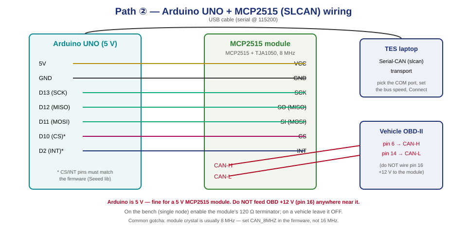

# Guide 02 — Arduino + MCP2515 as an SLCAN dongle

The cheapest DIY interface: an Arduino UNO/Nano and an MCP2515 CAN module flashed with **SLCAN
(Lawicel)** firmware. It shows up on your laptop as a **USB serial port**, and TES talks to it with
its **Serial-CAN (slcan)** transport. No network, no Pi — just a USB dongle.



> ⚠️ Read the [README safety section](README.md#️-read-this-before-you-plug-anything-into-a-car) first.
> The Arduino is 5 V and USB-powered — **never** feed OBD +12 V (pin 16) anywhere near it.

> 💡 **Prefer to buy, not build?** A **CANable 2.0** or an **SH-C30L** is an slcan dongle out of the
> box and skips this whole guide — see [Guide 03](03-Recommended-Hardware.md#arduino--turnkey-slcan). Build your own if you want
> to learn CAN or you already have the parts.

---

## 1. What you need

| Item | Notes |
|------|-------|
| Arduino **UNO** or **Nano** | Any ATmega328P board. 5 V logic. |
| **MCP2515 CAN module** | The common "blue board" (MCP2515 + TJA1050), usually an **8 MHz** crystal. |
| Jumper wires | Female-female Dupont, or a Seeed CAN-BUS Shield (plug-on, no wiring). |
| OBD-II → DB9 cable *or* OBD-II breakout | To tap CAN-H / CAN-L / GND from the car. |
| USB cable | Arduino → laptop. |

> 📷 **PHOTO:** `diagrams/photos/20-arduino-parts.jpg` — the Arduino, MCP2515 module and cable.

---

## 2. Wire the MCP2515 to the Arduino

SPI, 7 wires. (A Seeed CAN-BUS Shield does this for you — just plug it on and skip to §3, but note
its CS pin is **D9**.)

| MCP2515 module | Arduino UNO pin | Wire |
|----------------|-----------------|------|
| VCC | **5V** | red |
| GND | **GND** | black |
| SCK | **D13** | SPI clock |
| SO (MISO) | **D12** | SPI data in |
| SI (MOSI) | **D11** | SPI data out |
| CS | **D10** *(or D9 — must match the firmware)* | chip select |
| INT | **D2** *(optional for polled firmware)* | interrupt |

Then the **CAN side** of the module to the vehicle:

| MCP2515 module | Vehicle OBD-II | DB9 (if using a cable) |
|----------------|----------------|------------------------|
| CAN-H | **pin 6** | pin 3 |
| CAN-L | **pin 14** | pin 5 |
| GND (CAN reference) | **pin 4 or 5** | pin 1/2 |

> **Common ground matters.** Tie the vehicle ground (OBD pin 4/5) to the Arduino/module GND, or CAN
> will be flaky. To avoid a ground loop, run the **laptop on battery** (unplugged from mains) while
> connected to a vehicle.
>
> **Do NOT connect OBD pin 16 (+12 V).** The Arduino is powered from USB.

> 📷 **PHOTO:** `diagrams/photos/21-arduino-wired.jpg` — the finished wiring, both SPI and CAN sides.

---

## 3. Flash the SLCAN firmware

We use **`latonita/arduino-canbus-monitor`** — it implements the Lawicel CAN232/CANUSB **SLCAN**
ASCII protocol (the same protocol TES's slcan transport speaks): `S0`–`S9` (bitrate), `O`/`L`/`C`
(open / listen-only / close), `t`/`T`/`r`/`R` (send std/ext data & RTR frames).

1. Install the **[Arduino IDE](https://www.arduino.cc/en/software)**.
2. Get the firmware and its library:
   ```bash
   git clone https://github.com/latonita/arduino-canbus-monitor.git
   ```
   It uses a fork of Seeed-Studio's **CAN_BUS_Shield** library. Copy the library folder into your
   Arduino `libraries/` directory (e.g. `~/Documents/Arduino/libraries/`), or install Seeed's
   `CAN_BUS_Shield` from the Library Manager.
3. Open the sketch (`.ino`) in the Arduino IDE.
4. **Set two things to match your hardware** near the top of the sketch:
   - **CS pin** — `SPI_CS_PIN` must be **10** for the wiring above (or **9** for a Seeed shield).
   - **Crystal** — the MCP2515 clock must match your module's crystal. Blue modules are almost always
     **8 MHz**, so the init must use the 8 MHz option (e.g. `MCP_8MHz` / `CAN_8MHZ`), **not** 16 MHz.
     Read the crystal can (`8.000` vs `16.000`). Wrong value = the dongle connects but every bit time
     is wrong and you see nothing.
5. Select **Tools → Board → Arduino UNO** (or Nano) and the correct **Port**, then **Upload**.
6. Note the firmware's serial speed — the examples use **115200 baud** (this is the USB serial speed
   between laptop and Arduino, *not* the CAN bitrate).

> 📷 **PHOTO:** `diagrams/photos/22-arduino-ide-upload.jpg` — the IDE with the board/port selected, uploaded OK.

### Quick bench sanity-check (optional, before TES)

On a Linux box you can prove the firmware with `can-utils`:

```bash
# bind the serial port as an slcan interface (adjust ttyUSB0 / speed):
sudo slcand -o -s6 -t hw -S 115200 /dev/ttyUSB0 can0   # -s6 = 500 kbit/s
sudo ip link set can0 up
candump can0
```

`-s6` = 500 k, `-s5` = 250 k, `-s4` = 125 k, `-s3` = 100 k (the Lawicel S-command table).

---

## 4. Connect from Tester Engineering Suite

1. Plug the Arduino into the TES laptop. It enumerates as a USB serial port (a CH340 or an Arduino
   `ATmega16U2` COM port).
2. In TES, click **Refresh/Scan devices**. TES probes serial ports for slcan adapters and lists the
   dongle in the device list (alongside J2534 / RP1210 devices).
3. Select the dongle's **COM port** entry, pick the **bus speed** (500 k light / 250 k J1939 /
   125 k MS-CAN), set TX/RX IDs / 29-bit as needed, and click **Connect**.
4. TES sends the matching `S` command to set the bitrate, opens the channel (`O`), and runs its
   ISO-TP + UDS/OBD stack over the frames. **Read Vehicle Info** to confirm.

> 📷 **PHOTO:** `diagrams/photos/23-tes-serialcan-connect.jpg` — the dongle selected in the TES device list, connected.

> TES runs ISO 15765-2 (ISO-TP) reassembly **in software** over the raw frames the dongle delivers,
> so multi-frame UDS (long DID reads, flashing) works — but at USB-serial latency, so it is slower
> than a J2534 adapter. Fine for diagnostics; **not** recommended for flashing.

---

## 5. Troubleshooting

| Symptom | Cause / fix |
|---------|-------------|
| Dongle not in the TES device list | Driver missing (install the **CH340** driver for clone boards); wrong COM port; firmware not uploaded. Check it appears in Device Manager. |
| Connects but **no traffic** | **Wrong crystal setting** (8 vs 16 MHz — the #1 issue); wrong bitrate; CAN-H/CAN-L swapped; no common ground. |
| Only errors / nothing on a known-good car | CAN-H/CAN-L swapped; module terminator ON while on a vehicle (should be OFF — snip/disable the module's 120 Ω for in-car use); bitrate mismatch. |
| Upload fails in Arduino IDE | Wrong board/port; another program holds the port; press reset during upload on some clones. |
| Works on the bench, flaky in the car | Add the **common ground** (OBD pin 4/5 → Arduino GND); run the laptop on battery to avoid a ground loop. |
| Garbage frames at high bus load | The ATmega328P + serial link can't keep up with a busy 500 k bus. Use listen-only + filters, or move to the Pi/SocketCAN path (Guide 01) or a faster CANable. |

---

## 6. Bench termination

A lone dongle on a **bench** CAN bus (one ECU) needs 120 Ω at each end. The blue modules usually
have a 120 Ω resistor fitted — fine on the bench. **On a vehicle, that resistor must be OFF** (the
car already has 60 Ω); remove/disable it, or use a module without one, or the screw-terminal path.

---

**Next:** [Guide 03 — Recommended hardware](03-Recommended-Hardware.md) · [Guide 01 — Raspberry Pi / SocketCAN](01-RaspberryPi-SocketCAN-socketcand.md)

### Sources
- [latonita/arduino-canbus-monitor (SLCAN firmware)](https://github.com/latonita/arduino-canbus-monitor) · [Lawicel/SLCAN on CANable](https://canable.io/getting-started.html)
- [Seeed CAN-BUS Shield library](https://github.com/Seeed-Studio/Seeed_Arduino_CAN) · [Arduino + MCP2515 + SH-C30L walkthrough](https://www.hackster.io/rachnajain/pc-based-can-analyzer-using-sh-c30l-arduino-uno-mcp2515-597385)
- [OBD-II → DB9 cable pinout (Core Electronics, AU)](https://core-electronics.com.au/obd-ii-to-db9-cable.html)
