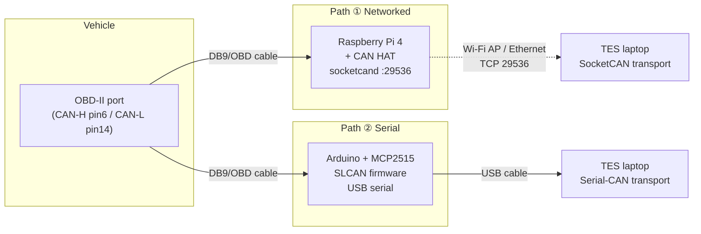

# DIY Interfaces for Tester Engineering Suite

Build your own CAN-bus interface for Tester Engineering Suite (TES) from off-the-shelf parts.
Two proven paths are documented here, each mapping onto a transport TES already speaks:

| Path | Hardware | TES transport | Connect in TES via |
|------|----------|---------------|--------------------|
| **① Raspberry Pi + SocketCAN** | Raspberry Pi 4 + CAN HAT (PiCAN3 / Waveshare / MCP2515) running **socketcand** over Wi-Fi or Ethernet | **SocketCAN (network)** — software ISO-TP, 11/29-bit | *Developer menu → SocketCAN (network)* → host / port `29536` / `can0` |
| **② Arduino + MCP2515** | Arduino UNO/Nano + MCP2515 module flashed with **SLCAN** firmware | **Serial-CAN (slcan)** — software ISO-TP, 11/29-bit | Device list → the slcan COM port → Connect |




## Which one should I build?

- **Path ① (Raspberry Pi / SocketCAN)** — *recommended for shop use.* Wireless (no USB tether to the car), can be powered straight off the OBD port, and is the most robust. More setup. **[→ Guide 01](01-RaspberryPi-SocketCAN-socketcand.md)**
- **Path ② (Arduino / slcan)** — *cheapest and simplest.* A USB dongle you plug into the laptop. Great for the bench and for learning. **[→ Guide 02](02-Arduino-slcan-MCP2515.md)**

**[→ Recommended hardware & shopping list (03)](03-Recommended-Hardware.md)** — PiCAN3 + 12 V SMPS, case, DB9↔OBD cable, Arduino options, with AU + international vendors.

---

## ⚠️ Read this before you plug anything into a car

These interfaces connect a computer directly to a vehicle's CAN bus, and TES can **transmit** (OBD, UDS, routines, even flashing). Treat them as professional tools.

1. **Get the pinout right.** OBD-II pin 16 carries **+12 V battery, always live**. If +12 V reaches a CAN line or an MCP2515 input you will destroy the interface and possibly a module. **Buzz out every cable with a multimeter before it touches a vehicle.** See the [DB9 ↔ OBD-II pinout](diagrams/db9-obd-pinout.svg).
2. **Do NOT add bus termination on a vehicle.** A car's CAN bus is already terminated (120 Ω at each end ECU = 60 Ω). Adding the HAT's 120 Ω jumper makes 40 Ω and causes bus errors. **Leave the terminator OFF for vehicle work;** only enable it on a bench bus that has a single node.
3. **Battery drain.** OBD pin 16 is *not* ignition-switched. A Pi powered from the OBD port will flatten the battery over days — unplug it, or power the Pi separately for long jobs.
4. **Clean shutdown the Pi.** Never just cut power to a running Raspberry Pi — you will corrupt the SD card. `sudo shutdown now` first.
5. **socketcand has no authentication.** Anyone who can reach TCP `29536` can read *and write* the vehicle bus. Bind it to your Wi-Fi AP / a point-to-point Ethernet link only, use a WPA2 password, and never expose it to the internet. See the [security note](01-RaspberryPi-SocketCAN-socketcand.md#13-security--this-is-an-open-door-to-the-bus).
6. **Listen-only when you only want to watch.** TES's SocketCAN dialog has a *Listen-only* checkbox; tick it for passive sniffing so the interface neither ACKs nor transmits. Clear it only when you intend to run active diagnostics.
7. **Correct bus speed.** Light-vehicle HS-CAN / OBD-II = **500 kbit/s**. Ford MS-CAN = **125 kbit/s** (pins 3/11, not 6/14). J1939 heavy = **250 kbit/s** (or 500 k for J1939-14). Pick the wrong speed and the bus reads dead.

---

## Repository contents

```
Tester-Engineering-DIY/
├── README.md                                  ← you are here
├── 01-RaspberryPi-SocketCAN-socketcand.md     ← Pi + CAN HAT + socketcand (Wi-Fi/Ethernet)
├── 02-Arduino-slcan-MCP2515.md                ← Arduino + MCP2515 slcan dongle
├── 03-Recommended-Hardware.md                 ← parts list, vendors, prices
└── diagrams/
    ├── system-architecture.svg
    ├── db9-obd-pinout.svg
    ├── pican3-wiring.svg
    ├── arduino-mcp2515-wiring.svg
    └── photos/                                ← drop your own build photos here
```


---

*Tester Present Specialist Automotive Solutions — tester tooling documentation.*
